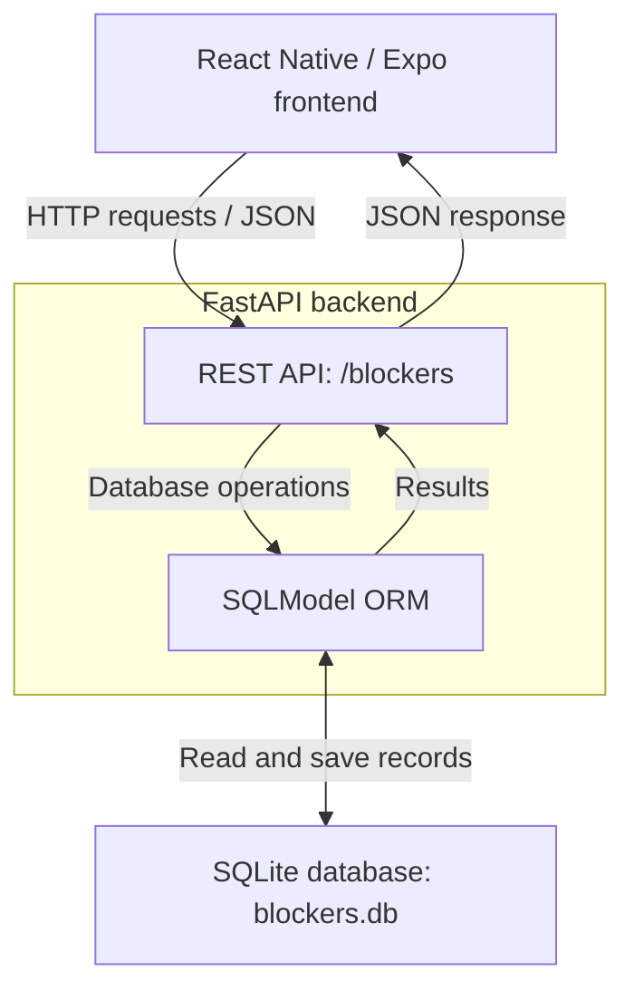

# System Architecture Notes

This app lets developers report blockers and track their status.

- **React Native / Expo:** Displays the screens and collects user input.
- **FastAPI:** Handles API requests and validates the data.
- **SQLModel:** Connects Python objects to database records.
- **SQLite:** Stores blockers in `backend/blockers.db`, keeping saved data between restarts.

## Submitting a Blocker

1. The form trims extra spaces and checks that all fields are filled in.
2. The frontend sends the data as JSON through `POST /blockers`.
3. FastAPI checks the data against `BlockerCreate`. Status defaults to `open`.
4. The backend creates a `Blocker` object. SQLModel adds it to a session, commits it to SQLite, and refreshes it to get the generated ID.
5. The API returns the saved blocker with status `201 Created`.
6. The frontend uses the ID to open the detail screen and load the blocker.

The form shows a loading indicator while submitting and displays an error if the request fails.

## Testing

I ran the backend on port 8000 and the frontend on port 8081. I submitted a test blocker for Grace and confirmed it appeared in the API response and detail screen with ID 3 and status `open`.

The main list still showed “No blockers found,” even though the API returned records. I’ll investigate this in Task 2.